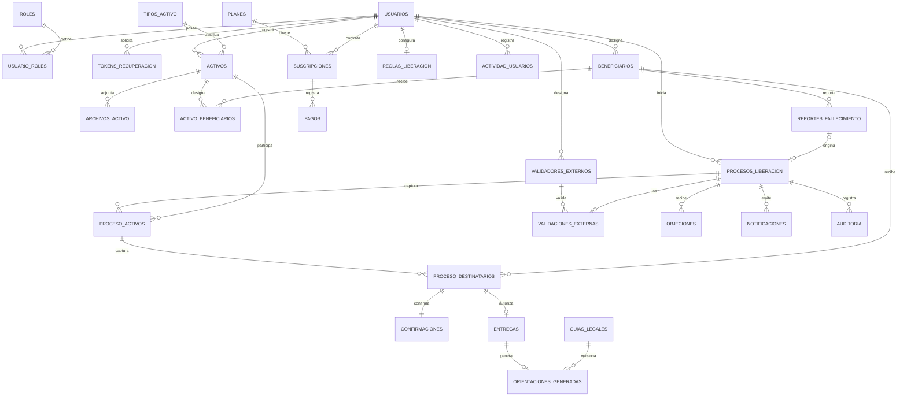

# LegadoSeguro — modelo relacional v1.0

**Base del diseño:** informe de avance v1.7, capítulos II–III y anexo C, y seis decisiones del equipo confirmadas el 17 de septiembre de 2026. La propuesta no reproduce un modelo ER previo: el informe todavía lo dejaba pendiente.

## Decisiones cerradas

1. Beneficiarios registrados por propietario, **sin cuenta obligatoria**. `beneficiarios` no apunta obligatoriamente a `usuarios`.
2. Una regla general vigente por propietario, `reglas_liberacion(propietario_id PK)`; cada proceso conserva versión y parámetros en snapshot.
3. Inactividad y reporte solo detectan riesgo; para continuar se requiere contacto registrado, revisión administrativa y, cuando el propietario lo haya designado, validación externa. Todo esto es **simulado/manual en el proyecto**.
4. Un expediente por propietario, con estado **independiente por activo** y una autorización por destinatario del activo.
5. Datos descriptivos públicos y contenido recuperable cifrado (AES-256-GCM **en Java**, no en SQL Server). La base almacena bytes cifrados, nonce, tag e identificador de clave. No se guardan claves maestras en BD.
6. Scripts de esquema, 35 procedimientos, datos ficticios y casos de prueba.

## Suposiciones adicionales que deben validarse con usuarios y docente

- **Todos** los beneficiarios asociados a cada activo deben confirmar antes de autorizarlo. RF-24 exige unanimidad expresamente para activos financieros; se extiende por precaución a los demás. Si deciden entrega independiente por destinatario, hay que modificar `sp_evaluar_liberacion`, `sp_autorizar_entrega` y `sp_consumir_entrega`.
- Los períodos de espera comienzan tras la revisión administrativa, no al primer indicio de inactividad.
- La actividad autenticada posterior a la detección cancela procesos no completados y revoca accesos todavía no consumidos.
- Los cambios de activos, archivos, beneficiarios y designaciones se congelan mientras un expediente esté abierto; el propietario puede cancelarlo, modificar sus datos y comenzar otro. Las relaciones históricas son snapshots.
- Si hay validadores externos activos, basta una validación externa aprobada y revisada para el expediente; no se requiere unanimidad de validadores.
- Un reporte externo no equivale a una declaratoria de herederos ni constituye comprobación jurídica del fallecimiento.
- **FINANCIERO:** solo se entrega una guía orientativa versionada. El procedimiento nunca devuelve su contenido cifrado ni sus archivos y no conoce contraseñas bancarias.
- Un archivo pesa hasta 5 MiB en esta versión académica; en producción convendría almacenamiento de objetos cifrados, con metadatos en SQL.

## Diagrama entidad-relación (vista resumida)

## Tablas y claves principales

| Área | Tablas | PK / integridad clave |
|---|---|---|
| Acceso | `roles`, `usuarios`, `usuario_roles`, `tokens_recuperacion` | PK por entidad; email normalizado único, hash de contraseña y tokens hashed de recuperación. |
| Personas designadas | `beneficiarios`, `validadores_externos` | FK a propietario; email único **dentro** del propietario, permite duplicación entre propietarios. |
| Activos | `tipos_activo`, `activos`, `archivos_activo`, `activo_beneficiarios` | FK compuestas `(activo_id, propietario_id)` y `(beneficiario_id, propietario_id)` bloquean enlaces entre propietarios. |
| Condiciones | `reglas_liberacion`, `actividad_usuarios` | Una regla por propietario y actividad con marcas UTC. |
| Expediente | `reportes_fallecimiento`, `procesos_liberacion`, `proceso_activos`, `proceso_destinatarios` | Un expediente no finalizado por propietario; snapshots por activo y destinatario, FK compuestas. |
| Revisiones | `validaciones_externas`, `confirmaciones`, `objeciones` | Confirmación una por `(proceso, activo, beneficiario)`; token único cuando existe; objeción suspende. |
| Entrega | `entregas`, `guias_legales`, `orientaciones_generadas` | Una entrega por destinatario/activo/proceso; token de acceso único; orientación versionada. |
| Operación | `notificaciones`, `auditoria` | Estado de envío y trazabilidad; sin incluir el secreto en los mensajes/auditoría. |
| Plan | `planes`, `suscripciones`, `pagos` | Una suscripción activa por usuario; pagos exclusivamente sandbox; sin PAN ni CVV. |

**Total: 27 tablas.** Los `CHECK`, `UNIQUE`, índices filtrados, FK y vistas están en `01_esquema.sql`. Los procedimientos no otorgan acceso directo a las tablas sensibles al rol de aplicación.

## Máquina de estados

**Proceso:** `DETECTADO → CONTACTADO → CONFIRMACIONES ↔ ESPERA → LISTO → COMPLETADO` (puede completar aunque algunos activos se vayan entregando antes que otros). Excepciones: `SUSPENDIDO`, `CANCELADO`, `RECHAZADO`.

**Activo del proceso:** `PENDIENTE → LISTO → AUTORIZADO → COMPLETADO`. Un activo puede estar COMPLETADO mientras otro continúe PENDIENTE.

**Confirmación:** `PENDIENTE → ACEPTADA | RECHAZADA`; identidad `PENDIENTE → VERIFICADA | RECHAZADA`.

**Entrega:** `AUTORIZADA → ACCESADA | REVOCADA`. El acceso se consume una vez; al vencer, se puede emitir un nuevo token solo si no se accedió ni se cerró el proceso.

## Reglas de seguridad comprobables

- La entrega exige proceso verificado, período concluido, cero objeciones pendientes, confirmaciones de **todos** los destinatarios del activo, e identidad revisada.
- Se impide un segundo proceso abierto por propietario con índice único filtrado.
- La actividad autenticada del propietario cancela el proceso todavía abierto y revoca entregas no accedidas.
- Las pruebas fuerzan el reloj **solo** modificando temporalmente `espera_hasta` dentro de transacciones de laboratorio que se revierten. Nunca usar este privilegio en la aplicación.
- No hay borrado en cascada para procesos, auditoría o entregas.
- Todas las fechas son UTC (`SYSUTCDATETIME()`). Java debe transformarlas a la zona horaria de la interfaz.
- `segundo_factor_validado=1`, revisión manual de identidad y referencias de evidencia son **contratos con Java**, no verificaciones autónomas de la BD. No implican seguridad real sin implementarlas externamente.

## Cobertura por módulo

| Módulo | Persistencia |
|---|---|
| M1 | Usuarios, roles, usuario_roles, tokens_recuperacion, confirmaciones.identidad_* |
| M2 | Tipos de activo, activos, archivos_activo, activo_beneficiarios |
| M3 | Beneficiarios, validadores_externos, validaciones_externas |
| M4 | Reglas_liberacion, actividad_usuarios, procesos_liberacion |
| M5 | Procesos_liberacion, proceso_activos, proceso_destinatarios, confirmaciones, entregas |
| M6 | Guias_legales, orientaciones_generadas |
| M7 | Notificaciones |
| M8 | Auditoria, vw_resumen_procesos |
| M9 | Planes, suscripciones, pagos |
| M10 | Reportes_fallecimiento, objeciones, validaciones_externas, auditoria |

## Decisiones posteriores a esta entrega

Para que sea una **aplicación funcional** y no solo una base de datos, implementar después: autenticación/session y propiedad del recurso en cada endpoint Java, Argon2id/bcrypt, generación segura de tokens, AES-256-GCM con rotación y gestión externa de claves, envío real de email y reintentos, verificación de identidad/evidencia con soporte jurídico, doble factor real para acceder, validación del webhook sandbox, antivirus y análisis de archivos, políticas de retención, respaldo/restauración y pruebas end-to-end. No se implementan mediante SQL solamente.
